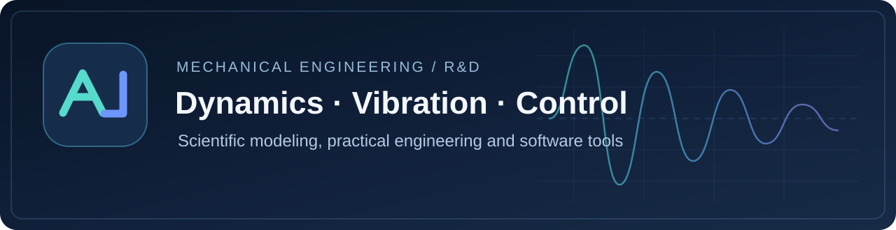

  <a href="https://github.com/TandemVector-Labs">TandemVector Labs</a> &nbsp;·&nbsp;
  <a href="https://github.com/mohammadmohammadzadeh19960-code">Co-steward: MMZ</a> &nbsp;·&nbsp;
  <a href="https://github.com/TandemVector-Labs/.github/blob/main/PROJECT_CATALOG.md">Project directory</a>

# Aliakbar Emadoddin

**Mechanical Engineering PhD researcher** · Dynamics, Vibration & Control · Engineering R&D · Independent Software Development

My work connects scientific modeling, practical engineering, and tools that help researchers and developers manage complex technical projects. I am interested in vibration analysis, mechanical product development, sensor-related research, reproducible workflows, and responsible uses of AI in engineering.

## Full engineering & software portfolio

**[Full engineering & software portfolio](PORTFOLIO.md)** — **26 evidence-labeled project/prototype tracks** covering advanced mechanical design, 2D/3D electromagnetic and CAD work, 9-channel operational modal analysis, native CAD automation, cross-platform software products and tested MATLAB/Python algorithms.

**[Engineering & research](portfolio/engineering-case-studies/README.md)** · **[Released software & systems](portfolio/software-systems/README.md)** · **[Tested FDD, LQR and TMD demos](portfolio/advanced-demos/README.md)** · **[MATLAB truss example](portfolio/matlab-three-bar-truss/README.md)**.

**[رزومهٔ فارسی آمادهٔ کارلنسر و پارس‌کدرز](FREELANCE_PROFILE_FA.md)** — متن کامل، معرفی کوتاه، عنوان تخصصی و کلیدواژه‌های خدمت.

**پورتفولیوی فنی:** نمونه‌کارهای واقعی و مستند مهندسی مکانیک، شبیه‌سازی، اتوماسیون CAD و نرم‌افزارهای منتشرشده، به‌همراه نمونه‌های محاسباتی مستقلِ آزمایش‌شده؛ وضعیت تحقیق، انتشار و پذیرش در هر بخش به‌صورت شفاف مشخص شده است.

## Industrial engineering and innovation leadership

**[Explore CV-reported industry, applied R&D and product commercialization experience](portfolio/industry-leadership-experience/README.md).** Career areas include automotive NVH, gearbox quality/test concepts, appliance and seat engineering, driving-cycle research, engineering management and university innovation partnerships. Sources are the owner's historical personal CVs; independent employer certification and numerical outcome validation are separate checks.

## Engineering project collaboration

**[Request technical engineering analysis or software work](ENGINEERING_SERVICES.md)** — clear scope, required inputs, potential deliverables and acceptance criteria for MATLAB, mechanical dynamics, COMSOL heat/flow preflight and technical software. Estimates depend on project data and appropriate licensing. [Contact via LinkedIn](https://www.linkedin.com/in/aliakbar-emadoddin-3bb8b5b8/).

## Research and engineering

I pursue doctoral research in **mechanical engineering**, with an emphasis on **dynamics, vibrations, and control**. I also work across product R&D and technology/innovation initiatives.

**Relevant collaboration:** applied mechanics, vibrations, sensor systems, engineering simulation, research-to-product development, and technical workflow design.

For research and professional collaboration, please use [my LinkedIn profile](https://www.linkedin.com/in/aliakbar-emadoddin-3bb8b5b8/).

## Verified engineering computation sample

**[MATLAB three-bar truss mass optimization](portfolio/matlab-three-bar-truss/README.md)** — independent, reproducible synthetic demonstration of finite-element-style stiffness assembly, member stress/displacement constraints and multistart numerical mass optimization. MATLAB R2025b execution passed, with **62.371% mass reduction for the educational example only**. [Inspect original MATLAB source](portfolio/matlab-three-bar-truss/truss_optimization_demo.m). **Not commissioned work; no global-optimum claim.**

## Shared engineering portfolio

I also contribute to **[TandemVector Labs](https://github.com/TandemVector-Labs)**, a jointly stewarded engineering and software R&D collective. Individual project provenance, licensing, and release authority remain with their respective repositories.

**Joint GitHub stewardship:** [GOD13emad](https://github.com/GOD13emad) and [MMZ](https://github.com/mohammadmohammadzadeh19960-code) share management of the organization. This does not change authorship, ownership, or the official release location of any personal upstream.

## Independent developer projects

These projects serve different purposes and have distinct release maturity.

### [ChatGPT Remote Commander](https://github.com/GOD13emad/ChatGPTRemoteCommander)

A cross-platform **Windows/Linux MCP server** that lets authorized owners interact with their own machines and technical projects from ChatGPT. Focus areas include bounded file and command operations, permission controls, execution evidence, and recoverable project workflows. Advanced features depend on permissions, configuration, and release status.

**For:** software developers, research engineers, and technical teams who want accountable ChatGPT-to-machine workflows.

[Installation and current capabilities](https://github.com/GOD13emad/ChatGPTRemoteCommander/blob/main/START_HERE.md) · [Share a real use case or feedback](https://github.com/GOD13emad/ChatGPTRemoteCommander/issues/154)

### [Remote Commander Browser](https://github.com/TandemVector-Labs/remote-commander-browser)

A **separate, unofficial CEF-based desktop browser shell** for ChatGPT-oriented workflows, with native tabs, Persian/Arabic RTL support, and carefully scoped permissions. The current repository documents **candidate-stage software**, not a universally qualified stable product. It is **not** the Remote Commander MCP server.

**For:** Linux desktop users, CEF developers, UI/UX testers, and people evaluating dedicated multilingual ChatGPT browser interfaces.

[Current build and status](https://github.com/TandemVector-Labs/remote-commander-browser#readme) · [Share focused browser feedback](https://github.com/TandemVector-Labs/remote-commander-browser/issues/78)

### [Appearance Studio Core](https://github.com/TandemVector-Labs/AppearanceStudio-Core)

**Appearance Studio** is a Linux/GNOME desktop appearance center with verified Theme Packs, bounded settings changes and transactional rollback. Its project README identifies individual authorship and the **Arclenor Technologies** product brand; organization hosting does not imply joint authorship.

**Current status:** `v0.9.0` **release candidate**, with GNOME 50 live validation still required before stable acceptance. A Windows version is planned, **not shipped**.

[Source, requirements and current limitations](https://github.com/TandemVector-Labs/AppearanceStudio-Core#readme) · [Release history](https://github.com/TandemVector-Labs/AppearanceStudio-Core/releases)

> **Independent work:** Neither ChatGPT Remote Commander nor Remote Commander Browser is an official OpenAI application or endorsed by OpenAI. Appearance Studio follows its own platform and release policy. University roles and research activity do not imply institutional endorsement of these software projects.

## Choose the right conversation

| Your interest | Best starting point |
| --- | --- |
| Controlling an authorized Windows/Linux machine or technical workflow from ChatGPT | [Remote Commander](https://github.com/GOD13emad/ChatGPTRemoteCommander/issues/154) |
| Desktop browser shell, CEF, tabs, RTL, clipboard, or UI testing | [Remote Commander Browser](https://github.com/TandemVector-Labs/remote-commander-browser/issues/78) |
| GNOME desktop appearance, Theme Packs and reversible Linux customization | [Appearance Studio Core](https://github.com/TandemVector-Labs/AppearanceStudio-Core) |
| Mechanical engineering, dynamics/vibrations, sensors, and R&D collaboration | [LinkedIn](https://www.linkedin.com/in/aliakbar-emadoddin-3bb8b5b8/) |

## درباره من

**علی‌اکبر عمادالدین**، پژوهشگر دوره دکتری مهندسی مکانیک با تمرکز بر **دینامیک، ارتعاشات و کنترل** هستم و در زمینه تحقیق‌وتوسعه محصول و ابزارهای نرم‌افزاری مهندسی فعالیت می‌کنم.

- **Remote Commander:** ارتباط کنترل‌شده ChatGPT با رایانه و پروژه‌های فنی از طریق MCP.
- **Remote Commander Browser:** پوسته مرورگر مستقل مبتنی بر CEF، با پشتیبانی فارسی/RTL، در مرحله توسعه و آزمایش.
- **Appearance Studio Core:** نرم‌افزار مستقل تنظیم ظاهر GNOME؛ نسخهٔ Linux 0.9.0 در مرحلهٔ Release Candidate است و نسخهٔ Windows هنوز منتشر نشده است.
- **همکاری پژوهشی:** [پروفایل حرفه‌ای LinkedIn](https://www.linkedin.com/in/aliakbar-emadoddin-3bb8b5b8/).

برای هر موضوع، لطفاً از مسیر مرتبط با همان موضوع استفاده کنید.
