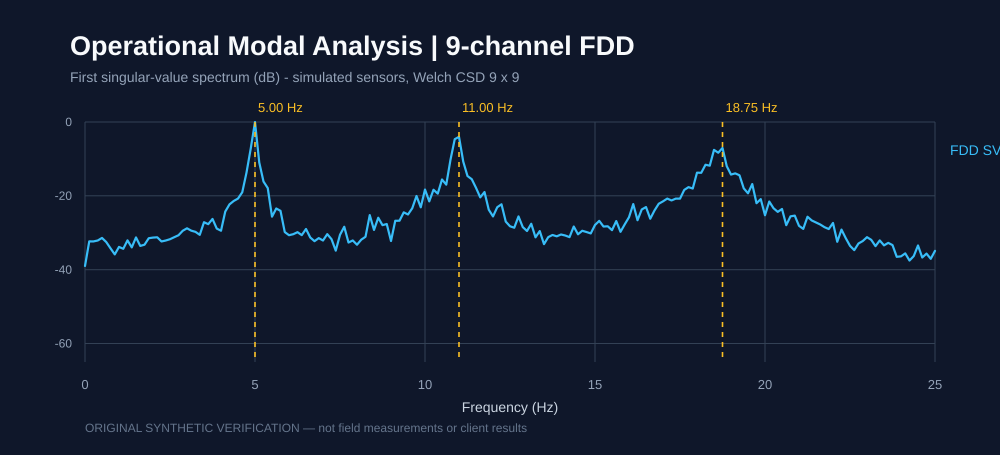
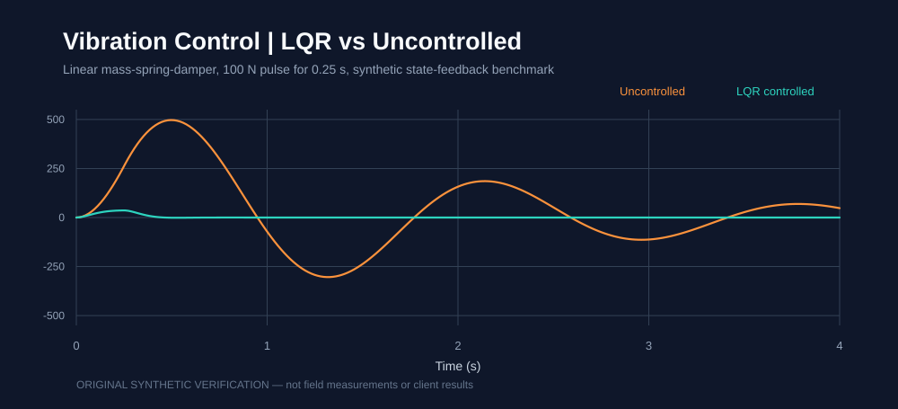
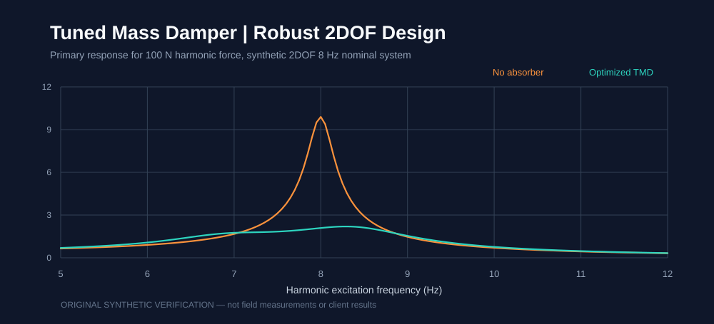

# Original Computational Verification Demos | نمونه‌های محاسباتی مستقل

**Status: scripts executed and assertions passed on owner Windows host (29 October 2026).** These are original independent *synthetic* demonstrations created to make the numerical methods inspectable; they are not client deliverables or experimental validation.

## Visual verification





These SVG figures were generated on the owner's Windows machine from the **same original tested Python sources**, using [render_advanced_demo_figures.py](render_advanced_demo_figures.py). Both are reproducible generated assets and represent synthetic test data, not measurements.

**Continuous integration:** [Numerical Portfolio QA](https://github.com/GOD13emad/GOD13emad/actions/workflows/numerical-portfolio-qa.yml) — successful matrix run [#40797023860](https://github.com/GOD13emad/GOD13emad/actions/runs/40797023860), with both **Python 3.11 and 3.12** passing the FDD and LQR assertions. Its prerequisite dependency-list follow-up fixed an earlier transient CI failure caused by referencing a requirements file before creating it.

## 1. Nine-channel Frequency Domain Decomposition (FDD)

Source: [nine_channel_fdd_demo.py](nine_channel_fdd_demo.py).

| Check | Observed result |
|---|---|
| Python libraries | NumPy, SciPy |
| Sensor records | 9 synthetic accelerometer-like channels × 32,768 samples |
| Sampling frequency | 256 Hz |
| Cross-spectrum | Welch, Hann, 8,192-sample window, 4,096 overlap |
| Generated modal resonance centres | 5.00, 11.00, 19.00 Hz |
| Dominant frequencies from FDD singular values | **5.00, 11.00, 18.75 Hz** |
| Maximum absolute peak-frequency error | **0.25 Hz** |
| Minimum modal assurance criterion (MAC) vs synthetic input shapes | **0.999578** |
| Spectral Hermitian residual | 2.48e-17 |
| Test result | `SYNTHETIC_FDD_9CH_PASS` |

The demo synthesizes **independently excited, damped modal response**, projects it to nine virtual sensors, computes the entire 9×9 **complex cross-spectral density**, performs frequency-by-frequency eigen/SVD-equivalent decomposition, selects three spectral peaks without querying the hidden generated resonances, and compares estimated frequencies and shapes **only after** identification.

**Limits:** The input is randomized *simulation*, **not a physical field measurement**; the algorithm does not uniquely reconstruct full physical M/C/K matrices, prove experimental damping, or establish real modal mass calibration. The 19 Hz peak exhibits **0.25 Hz bias**; no zero-error claim.

## 2. State-feedback LQR for mechanical vibration suppression

Source: [lqr_vibration_robustness_demo.py](lqr_vibration_robustness_demo.py).

| Check | Observed result |
|---|---|
| Plant | Linear 1-DOF mass–spring–damper, m=10 kg, c=12 Ns/m, k=150 N/m |
| Disturbance | 100 N, 0.25-second force pulse |
| Control | Continuous-time LQR (algebraic Riccati equation) |
| Uncontrolled peak displacement | **497.066 mm** |
| Controlled peak displacement | **36.296 mm** |
| Peak-displacement reduction in this synthetic test | **92.698%** |
| Peak controller effort | **113.620 N** |
| Robustness grid | **27** mass/damping/stiffness configurations, all closed-loop eigenvalues stable |
| Worst closed-loop eigenvalue real part | **−10.1908 1/s** |
| Test result | `SYNTHETIC_LQR_ROBUST_GRID_PASS` |

The robustness test varies m∈{8,10,12} kg, c∈{8,12,18} Ns/m and k∈{120,150,180} N/m, holding the nominal LQR gain unchanged and checking eigenvalue stability for every combination.

**Limits:** These are synthetic linear plant results; the absolute displacement is deliberately large due to the soft illustrative spring. No physical actuator, saturation, measurement noise, delay, discrete controller, hardware-in-the-loop or laboratory test was performed. The result is **not** a guaranteed improvement on a different plant.

## 3. Robust two-degree-of-freedom tuned mass damper (TMD)

**Original runnable source:** [robust_2dof_tmd_demo.py](robust_2dof_tmd_demo.py).



| Check | Verified synthetic result |
|---|---|
| Primary / absorber masses | 100 kg / 6 kg |
| Nominal primary resonance | 8 Hz |
| Harmonic force and sweep | 100 N, 5–12 Hz, 281 frequencies |
| Numerical optimizer | SciPy differential evolution with fixed seed |
| Tuned absorber frequency ratio | **0.909352** |
| Tuned absorber damping ratio | **0.169742** |
| Worst of three baseline primary peaks | **10.963598 mm** |
| Worst of three optimized primary peaks | **2.390874 mm** |
| Reduction of worst peak across the exact three-configuration grid | **78.193%** |
| ±5% primary natural-frequency tests | **3/3** reduced peak vs the corresponding unabsorbed model |
| Test result | `SYNTHETIC_2DOF_TMD_ROBUST_PASS` |

This is **original mathematical model verification** on a synthetic 2DOF frequency-response system. It does **not** demonstrate fabrication feasibility, measured damping, bearing/mount loads, fatigue, nonlinear vibration, control hardware, laboratory validation, or a client-specific mechanical absorber. The method uses a finite frequency sweep and a discrete three-configuration uncertainty grid; no global guarantee follows.

## Running the examples

```shell
python -m pip install numpy scipy
python nine_channel_fdd_demo.py
python lqr_vibration_robustness_demo.py
python robust_2dof_tmd_demo.py
```

All three scripts use fixed RNG seeds or fixed parameter grids, print machine-readable JSON with explicit `scope`, limits and `pass_checks`, and return a nonzero process status if the assertions fail. Exact original host-side source checksums at acceptance:

- FDD: `5014BED77DAB2CCB4C8BAAB47770C989C985BCA1524E33AAC37E01A6179ED9B4`
- LQR: `E5EF340D05072702EFF2C7A61467CE841CAAEBE5E30F3ADE9CD630177C468AC8`
- TMD: `7727AAD56004B69E0AEBBDCBBDAF2591FA2EBD9201CE2A4D591E1B9B97162F03`

## یادداشت فارسی

این سه تمرین **کد اصلی، قابل‌تکرار و با آزمون اجراشده** هستند. اولی تجزیهٔ دامنهٔ فرکانس (FDD) دادهٔ مصنوعی ۹ کاناله و استخراج فرکانس و شکل مود را آزمایش می‌کند؛ دومی طراحی کنترل‌کنندهٔ بهینهٔ LQR و پایداری در ۲۷ حالت عدم‌قطعیت پارامترهای مکانیکی را می‌سنجد؛ سومی بهینه‌سازی مقاوم جاذب ارتعاشی دو درجه آزادی (TMD) را با سه وضعیت فرکانس طبیعی بررسی می‌کند. هیچ‌یک جای دادهٔ واقعی کارفرما، صحت‌سنجی آزمایشگاهی یا پذیرش صنعتی را نمی‌گیرد.

## Supplemental original example: online congestion-game routing

An additional **independent synthetic Python example** demonstrates deterministic occupancy-sensitive route selection as drivers arrive. It is **not** a customer deliverable, empirical traffic optimization, or reproduction of a third-party article. Six synthetic drivers distribute 2/4 over two fictional routes, with a toy total latency of **47.48 driver-minutes** versus **165** if all use the free-flow-shortest option. No real-world saving is claimed. Five unit tests passed on the author's Windows machine; the GitHub numerical QA workflow also runs those tests for Python 3.11/3.12.

[Read the methodology, code, and unit tests](online_congestion_game/README.md). This supplemental demonstration does not alter the 26 separately evidence-classified case-study entries or imply any paid customer contract.

## Supplemental independent OpenSees-style Recorder postprocessing

A tested, dependency-free Python numeric file-to-SVG helper demonstrates basic handling of OpenSees-style time and response recorder outputs. **Eight local Windows unit tests passed** on fabricated input. It does **not** run OpenSees, validate a structural model, use client data or establish any contracted work. [Code, tests and limitations](opensees_recorder_plotting/README.md). This is supplemental and does not modify the count of evidence-classified primary case studies.

## Supplemental independent five-model regression evaluation

[Runnable source: regression_bid_pilot.py](regression_bid_pilot.py). This **synthetic, non-client** data-science demonstration implements five regressors (Ridge, ElasticNet, RandomForest, ExtraTrees, HistGradientBoosting) plus a mean-value baseline. Each model is evaluated through three-fold training-only cross-validation and a separate untouched 20% holdout. Numeric imputation/scaling and categorical encoding remain **inside the cross-validation pipelines** to reduce leakage. The report includes CV RMSE and held-out MAE/RMSE/R², with an optional chronological split for time-series CSVs.

**Execution evidence (local Windows, 30 October 2026):** with Python 3.14.7, scikit-learn 1.8.0, NumPy 2.4.6 and pandas 2.3.3, the 330-row synthetic self-test passed (20 features, 264 train / 66 holdout, all six algorithms evaluated). ElasticNet was selected by the training-only CV metric, with synthetic holdout R² ≈ 0.978357. A separate fabricated 240-row CSV with 20 features and a timestamp also passed the chronological 80/20 split and six-model evaluation. **Neither result is a client-data validation, deployment, paid contract, CI matrix pass, or promise of accuracy.** No datasets or credentials are bundled.

To reproduce in a local virtual environment:

```shell
python -m pip install numpy pandas "scikit-learn==1.8.0"
python regression_bid_pilot.py --self-test
python regression_bid_pilot.py --demo --rows 5000 --output report.json
python regression_bid_pilot.py --csv authorized-data.csv --target target --output report.json
# For dated rows with a true timestamp column:
python regression_bid_pilot.py --csv authorized-data.csv --target target --time-col timestamp
```

Real project acceptance requires permission to use the dataset, data-definition/target checks, leakage review (including grouped entities), model selection appropriate to the task, and agreed acceptance metrics. This sample is **supplemental** and does not change the evidence-classified primary case-study count.
